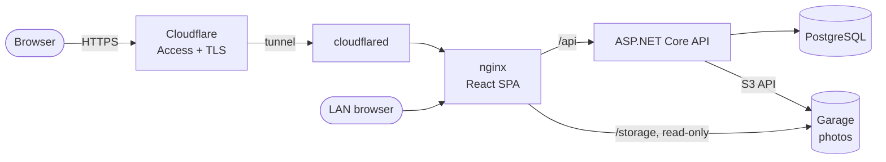

<h1 align="center">LabTracker</h1>
<div align="center">
  


</div>

>Equipment booking and usage tracking for research labs,
>built for the  Department of Molecular and Cell Biology
>at the University of Cape Town.


<p align="center">
  <a href="https://github.com/wizard-nazim/labtracker-workbench/actions/workflows/ci.yml"></a>
</p>

## Tech stack

<table align="center">
  <tr>
    <td width="420" align="center" valign="top">
      <pre><code>Frontend:</code></pre>
      
      <br /><sub>shadcn/ui · Radix · TanStack Query · React Router · Recharts · Motion</sub>
    </td>
    <td width="420" align="center" valign="top">
      <pre><code>Backend:</code></pre>
      
      <br /><sub>ASP.NET Core 10 · EF Core · FluentValidation · JWT + Google sign-in · SkiaSharp</sub>
    </td>
  </tr>
  <tr>
    <td width="420" align="center" valign="top">
      <pre><code>Infrastructure:</code></pre>
      
      <br /><sub>Docker Compose · Garage (S3 storage) · Cloudflare Tunnel · systemd timers · restic</sub>
    </td>
    <td width="420" align="center" valign="top">
      <pre><code>Testing &amp; CI:</code></pre>
      
      <br /><sub>xUnit · Testcontainers (PostgreSQL) · FluentAssertions · ESLint</sub>
    </td>
  </tr>
</table>

## Features


- **Equipment catalogue**: types, rooms, facilities and labs, with photos,
  status (available, faulty, under maintenance, retired) and assigned Science Officers. The
  department's 67-item list can be imported in one step.
- **Bookings**: internal bookings are approved automatically; external ones
  wait for approval. There are clear time ranges and booking cards on phones.
- **Usage records**, including walk-in use, and **reports** with filters and
  summary tiles.
- **Admin hub** for non-technical admins: Equipment, Rooms, People and
  Settings, each one page with search and a single ⋯ menu per row.
- **Sign-in**: email and password, or Google (Gmail and Workspace accounts that
  already have a login). Rate-limited per IP and per account.
- **In-app notifications** and short guided tours for new users and admins.
- UCT / MCB branding, light and dark themes, and layouts that work on phones.

Roles: **Super Admin** (everything), **Science Officer** (equipment they're
assigned to, or whose facility they oversee), **Principal Investigator** and
**Researcher** (their own and their group's bookings).

## Architecture



In production everything runs on one Docker host. Only nginx publishes a
port. PostgreSQL and Garage sit on an internal network with no internet
access. The Cloudflare Tunnel is optional and needs no inbound port. Details
are in the [deployment runbook](docs/deploy-homelab.md).

## Repository layout

```
backend/                 .NET 10 solution
  src/LabTracker.Api             controllers, auth, rate limiting, startup checks
  src/LabTracker.Application     use cases, DTOs, validation, MCB import data
  src/LabTracker.Domain          entities
  src/LabTracker.Infrastructure  EF Core, migrations, identity, seeding
  src/LabTracker.Shared          enums and shared exceptions
  tests/                         unit and PostgreSQL integration tests
frontend/                React SPA (src/features/<area>), nginx.conf for production
deploy/                  deploy, backup, restore, rehearsal and monitoring scripts; systemd units
docs/                    deploy-homelab.md: the self-hosted runbook
docker-compose.prod.yml  self-hosted production stack
render.yaml              alternative hosting: API on Render (frontend on Vercel)
```

## Documentation

| Document | What's in it |
|---|---|
| This README | local development, tests, configuration reference, hosting options |
| [docs/deploy-homelab.md](docs/deploy-homelab.md) | self-hosted runbook: deploy, verify, update, roll back, back up and restore, monitoring, Cloudflare Tunnel |
| [frontend/README.md](frontend/README.md) | frontend commands |
| [.env.production.example](.env.production.example) | every production setting, with notes |

## Local development

Prerequisites: .NET 10 SDK, Node 22+, Docker.

```bash
# 1. Postgres + MinIO (development only; Chainguard's build of MinIO)
cd backend
cp .env.example .env
docker compose up -d

# 2. API on http://localhost:5119 (Development: applies sample data on start)
dotnet tool restore
dotnet ef database update -p src/LabTracker.Infrastructure -s src/LabTracker.Api
dotnet user-secrets set "Jwt:SigningKey" "$(openssl rand -base64 48)" --project src/LabTracker.Api
dotnet run --project src/LabTracker.Api

# 3. Frontend on http://localhost:5173 (proxies /api to the API)
cd ../frontend
npm install
npm run dev
```

Development logins (password `ChangeMe123!`): `admin@labtracker.local`,
`so@labtracker.local`, `researcher@labtracker.local`.

### Tests

```bash
cd backend && dotnet test LabTracker.slnx   # unit + Postgres integration tests (needs Docker)
cd frontend && npm run lint && npm run build
```

CI (`.github/workflows/ci.yml`) runs all of the above, checks that no model change
is missing a migration, and builds both Docker images.

### Database changes

```bash
cd backend
dotnet ef migrations add <Name> -p src/LabTracker.Infrastructure -s src/LabTracker.Api
```

## Configuration

API settings (environment variables use `__` for `:`, e.g. `Jwt__SigningKey`):

| Setting | Required | Notes |
|---|---|---|
| `ConnectionStrings:DefaultConnection` | yes | Npgsql connection string |
| `Jwt:SigningKey` | yes | at least 32 bytes; the API refuses to start otherwise |
| `Jwt:Issuer`, `Jwt:Audience` | yes | defaults in `appsettings.json` |
| `Minio:ServiceUrl`, `AccessKey`, `SecretKey`, `Bucket`, `PublicBaseUrl` | for images | any S3-compatible store |
| `Cors:AllowedOrigins` | only cross-origin | not needed when the frontend is served from the same origin |
| `Database:MigrateOnStartup` | no | apply pending migrations when the API starts |
| `Bootstrap:AdminEmail`, `Bootstrap:AdminPassword` | first start | creates the first Super Admin on an empty database; remove afterwards |
| `Features:DemoDataReset` | no | enables Admin → "Reset demo data" (wipes everything). On only in Development |
| `Google:ClientId` | no | OAuth client ID for "Sign in with Google"; empty disables it. The client secret is not used |
| `RateLimiting:Login:PermitLimit`, `WindowSeconds` | no | sign-in attempts allowed per client IP per window (default 10 per 60 s); excess gets `429` |
| `Https:RedirectToHttps` | no | redirect plain-HTTP requests to HTTPS (default `true`). Set `false` where a proxy in front terminates TLS and does the redirect itself; the self-hosted compose stack does |
| `ForwardedHeaders:ForwardLimit` | no | proxy hops whose `X-Forwarded-For` entries are trusted (default 1). Keep 1 whenever the API is publicly reachable: a higher value lets a client spoof its IP |
| `Features:McbImport` | no | enables Admin → Settings → Data tools → "Import MCB equipment" (adds the client's 67-item equipment list once; it refuses to run again after equipment exists, and a run that failed part-way can be repeated). Set `Features__McbImport=true` on a deployment only while importing; imported science officers start inactive with placeholder emails |

Frontend (build time): `VITE_API_BASE_URL` only if the API is on a different
origin (it defaults to same-origin `/api`), and `VITE_GOOGLE_CLIENT_ID` to show
the Google button (same value as `Google:ClientId`).

**Google sign-in** only lets in people who already have an active LabTracker
login, matched by email; it never creates accounts. It accepts Gmail addresses
and Google Workspace accounts only: for any other address Google doesn't vouch
for the current owner, so those users sign in with their password. In Google Cloud Console →
Credentials → the OAuth client, add every site origin under *Authorized
JavaScript origins* (`http://localhost`, `http://localhost:5173`, and the
production URL). No redirect URIs are needed. While the consent screen is in
*Testing*, only listed test users can sign in.

Health check: `GET /health` (also reports whether the database is reachable).

## Production deployment

### Self-hosted (Docker Compose)

`docker-compose.prod.yml` runs the whole stack on one Docker host: nginx
(serves the SPA and proxies `/api` and `/storage`), the API, PostgreSQL,
[Garage](https://garagehq.deuxfleurs.fr/) for equipment photos, and,
optionally, `cloudflared` for public access through a Cloudflare Tunnel. Only
nginx publishes a port.

```bash
deploy/generate-env.sh          # writes .env.production with random secrets; edit the EDIT lines
deploy/deploy.sh                # backs up (if running), builds, starts, waits for health
deploy/install-systemd.sh       # nightly backups + 10-minute health checks (asks first)
deploy/restore-rehearsal.sh     # proves the newest backup restores, without touching live
```

| Script | Purpose |
|---|---|
| `deploy/backup.sh` / `restore.sh` | database dump plus storage volumes, with checksums; restore replaces live data |
| `deploy/offsite-backup.sh` | encrypted restic copy off the server (optional) |
| `deploy/monitor.sh` / `alert.sh` | health, disk, memory and backup-age checks; ntfy or Healthchecks alerts |

The full runbook (first deploy, updates, rollback, backups and restores,
monitoring, Cloudflare Tunnel) is in [docs/deploy-homelab.md](docs/deploy-homelab.md).

### Vercel (frontend) + Render (API)

The SPA can be hosted on Vercel and the API on Render's free plan instead of
the compose stack. `frontend/vercel.json` rewrites `/api/*` and `/health` to the
API, so the browser stays same-origin and no CORS setup is needed.

**Render** (API): Dashboard → New → Blueprint → this repo. `render.yaml`
creates a free Docker web service from `backend/Dockerfile` with the health
check, port and migration settings. It generates `Jwt__SigningKey` and asks
for the rest:

| Variable | Value |
|---|---|
| `ConnectionStrings__DefaultConnection` | Supabase **session pooler** string (Connect → Session pooler; port 5432), as `Host=...;Port=5432;Database=postgres;Username=postgres.<ref>;Password=...;SSL Mode=Require`. The direct `db.<ref>.supabase.co` host is IPv6-only |
| `Google__ClientId` | the OAuth client ID |
| `Bootstrap__AdminEmail`, `Bootstrap__AdminPassword` | first start only, then remove |
| `Minio__ServiceUrl`, `Minio__AccessKey`, `Minio__SecretKey`, `Minio__PublicBaseUrl` | S3 storage, e.g. Supabase Storage's S3 endpoint |

Free-plan limits: 512 MB RAM, a small CPU share, and the service **sleeps after
15 minutes without traffic** (the next request waits about a minute while it
starts). To keep it awake, point a free uptime pinger (e.g. cron-job.org or
UptimeRobot) at `https://<service>.onrender.com/health` every 10 minutes. One
service running all month fits in the 750 free hours. Because `/health` queries
the database, the ping also stops a free Supabase project from pausing for
inactivity.

**Vercel** (frontend): import the repo with root directory `frontend`
(framework Vite, build `npm run build`, output `dist`). Replace
`YOUR-API.onrender.com` in `frontend/vercel.json` with the Render domain.
Variable: `VITE_GOOGLE_CLIENT_ID`. Then add the Vercel URL to the Google
client's authorized JavaScript origins.

Requests reach the API through Vercel and then Render's proxy, so the per-IP
limit sees Vercel's addresses and many users can share one bucket. If people
hit `429`s during normal use, raise `RateLimiting__Login__PermitLimit` (e.g. 60)
rather than `ForwardedHeaders__ForwardLimit`: the Render domain is public, and
trusting more forwarded hops would let anyone fake their IP. Password guessing
is also capped per account, which no IP trick gets around: after 10 attempts in
15 minutes, that account's password sign-in returns `429` for the rest of the
window. The trade-off is that someone who knows a user's email can lock them out
of password sign-in for up to 15 minutes; users with a Gmail or Google Workspace
address can still use Google sign-in meanwhile.

**Supabase**: the app talks to Postgres directly and does not use Supabase's
Data API. Disable it (Project Settings → Data API), or the public publishable
key could read and write the app's tables over REST, since they have no RLS.
Schema changes come from EF migrations, not a `supabase/` folder.
