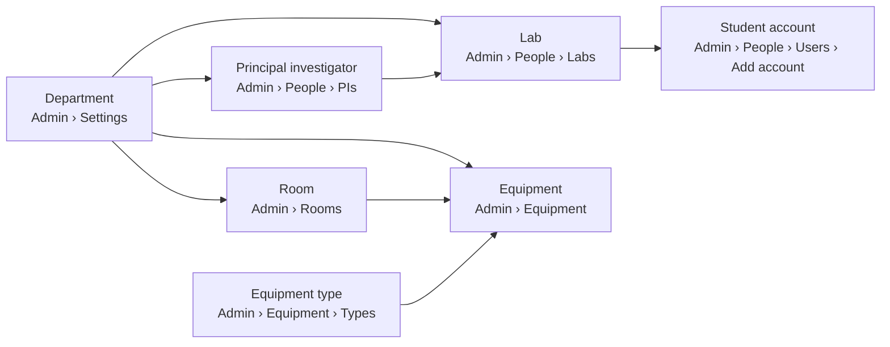

# Accounts and bookings workflow

How a Super Admin sets LabTracker up, adds students and staff, and how
bookings flow from there. Smoke-tested end to end on a local development stack
on 7 November 2026 (see [the last section](#smoke-test-record)).

## Roles

| Role | Signs in | Sees | Can |
|---|---|---|---|
| Super Admin | yes | everything, plus **Reports** and **Admin** | manage every account, password and setting; approve any booking. Cannot book equipment themselves. |
| Science Officer | yes | Dashboard, Equipment, Bookings, Usage | book; book for external visitors; approve or reject bookings for equipment they are assigned to (or in a facility they oversee); cancel any booking |
| Principal investigator | yes, when given a password | same as Science Officer, minus approving | book; book for external visitors |
| Researcher (student) | yes | Dashboard, Equipment, Bookings, Usage | book for themselves; cancel their own bookings |

Only a Super Admin creates accounts or sets passwords. Every `/admin` page and
the `/api/users` endpoints are restricted to Super Admins (a student calling
them gets `403`).

## Setup order

Some records need others to exist first. Set things up in this order:

| To add | You first need |
|---|---|
| Principal investigator | a department |
| Lab (research group) | a department and its principal investigator |
| Student account | at least one lab |
| Science Officer account | nothing (labs are optional) |
| Equipment | a room, an equipment type and an owning department |
| A Science Officer approving bookings | the officer assigned to that equipment, or overseeing its room's facility |

## Adding a student

1. **Admin › People › Users › Add account**, account type **Student**. Enter
   their full name, email, a temporary password (at least 8 characters) and
   student number, and tick at least one lab. This creates the login and the
   researcher profile together.
2. Give them the temporary password in person. Their row shows a **Temporary
   password** badge until they replace it.
3. The student signs in, chooses their own password and sees a short welcome
   tour.

**Admin › People › Researchers › Add researcher** is still there for a profile
without a login (for example someone who only appears in usage records).

## Adding a Science Officer

1. **Admin › People › Users › Add account**, account type **Science
   Officer**: full name, email and a temporary password. Staff number and labs
   are optional.
2. So they can approve bookings, either edit each piece of equipment they look
   after (**Admin › Equipment ›** row menu **› Edit › Science officers**) or
   make them an overseer of a facility (**Admin › Rooms › Facilities**).

Principal investigators are added from **Admin › People › Principal
investigators**; giving a password there also creates their login.

Another Super Admin is added the same way, account type **Super Admin**
(email and temporary password only).

## Passwords today

- A Super Admin sets anyone's password from **Admin › People › Users ›** row
  menu **› Edit login / set password**. Any password an admin sets is
  temporary: the user is asked to choose their own at their next sign-in.
- The forced change screen, changing your own password and "forgot password"
  are being added in the next releases.

## Booking

1. **Equipment ›** pick an item **› Book this equipment** (only shown while the
   item is *Available*).
2. Choose the day and the from/to times (tick *multiple days* for longer
   bookings), add an optional note, and press **Request booking**.
3. The booking appears under **Bookings** with its status.

Rules the system enforces:

- the start must be in the future, and the end after the start;
- no two active bookings for the same equipment may overlap (rejected with
  "This equipment is already booked for an overlapping time range.");
- equipment that is not *Available* cannot be booked.

## Approval

| Who the booking is for | Status after booking | Who decides |
|---|---|---|
| An internal person (student, PI, Science Officer booking for themselves) | **Approved** immediately | nobody; it is confirmed |
| An external visitor (booked by a Science Officer, PI or Super Admin) | **Requested** | a Super Admin, or a Science Officer assigned to that equipment |

The booker gets a notification (bell icon) when a requested booking is
approved or rejected. Managers see a **Needs my approval** filter on the
Bookings page when something is waiting for them.

## Cancelling

The person who made a booking can cancel it while it is *Requested* or
*Approved*. Super Admins and Science Officers can cancel any booking.

## Known quirks

- The button says **Request booking** even though internal bookings are
  approved straight away.
- Super Admins cannot book equipment; use a Science Officer account to book on
  someone's behalf.
- A Science Officer who isn't assigned to a piece of equipment can't approve
  its external bookings (`403`), even though they can create them.

## Smoke test record

Run on 7 November 2026 against the local development stack (API in
Development with seeded users, Vite on :5173), at commit `2211066`.

| Step | Result |
|---|---|
| Admin signs in and adds login `smoke.student@labtracker.local`, role Researcher | added, active |
| Admin adds researcher "Smoke Test Student" (STU9001, Okafor Lab) linked to that login | profile linked to the login (checked in the database) |
| Student signs in | welcome tour shown; sidebar has Dashboard, Equipment, Bookings, Usage only |
| Student books Centrifuge X200, Mon 9 Nov 10:00–11:00 | booking listed as **Approved** |
| Science Officer books Centrifuge X200 for an external visitor | status **Requested** |
| Same Science Officer (not assigned to the centrifuge) approves it | `403` |
| Super Admin approves it | **Approved** |
| Student books a time overlapping the visitor's booking | `400`, overlap message |
| Student calls `GET /api/users` | `403` |
